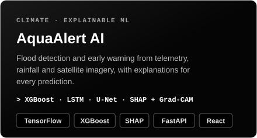

  

  
  
  
  

I build AI systems end to end, from the model or retrieval pipeline to the API and the interface people
actually use. Most of my work sits where **LLM agents, search and data engineering** meet:
multi-agent pipelines in LangGraph, hybrid retrieval with rerankers, Spark/Kafka/Neo4j data platforms,
medical-imaging models, and full-stack apps that are deployed and in use.

- 🤖 **Agents & GenAI:** LangGraph pipelines, RAG with FAISS / Pinecone and cross-encoder reranking, Gemini
- 🔎 **Search & ranking:** BM25 + dense retrieval, reciprocal rank fusion, explainable scoring
- 🛰️ **Data platforms:** HDFS, Spark (batch + Structured Streaming), Kafka, Neo4j graph analytics
- 🧠 **Computer vision & ML:** YOLOv8, U-Net / UNet++, XGBoost, SHAP and Grad-CAM explanations
- 🌐 **Full stack:** FastAPI, Node/Express, React, Next.js, MongoDB, MySQL, PostgreSQL, Docker

 

<table>
  <tr>
    <td width="50%"></td>
    <td width="50%"></td>
  </tr>
  <tr>
    <td width="50%"></td>
    <td width="50%"></td>
  </tr>
  <tr>
    <td width="50%"></td>
    <td width="50%"></td>
  </tr>
  <tr>
    <td width="50%"></td>
    <td width="50%"></td>
  </tr>
</table>

Click a card to open the project. School Monitor and System Design Atlas open the live sites; their code is in <a href="https://github.com/Abhxym/schoolmonitor">schoolmonitor</a> and <a href="https://github.com/Abhxym/system-design-atlas">system-design-atlas</a>.

 

<table>
  <tr>
    <td width="50%" valign="top">
      
      
<b>ClipMind AI</b> · upload clips, write a brief, watch 13 agents plan, caption and cut the reel.

    </td>
    <td width="50%" valign="top">
      
      
<b>SUPPLYCHAIN-X</b> · Typhoon Hagibis (2019) spreading through supply links from Japan, hop by hop.

    </td>
  </tr>
  <tr>
    <td width="50%" valign="top">
      
      
<b>RedRob AI</b> · ranked candidates for a job description, each with the signals behind its score.

    </td>
    <td width="50%" valign="top">
      
      
<b>InsightFlow</b> · survey analytics with plain-English questions and cited AI answers.

    </td>
  </tr>
  <tr>
    <td colspan="2" align="center" valign="top">
      
      
<b>School Monitor</b> · the cluster dashboard used to monitor 12 Zilla Parishad schools (<a href="https://schoolmonitor.vercel.app">live</a>).

    </td>
  </tr>
</table>

 

<table>
  <tr>
    <td><b>Languages</b></td>
    <td>
      
      
      
      
      
    </td>
  </tr>
  <tr>
    <td><b>AI & GenAI</b></td>
    <td>
      
      
      
      
      
      
    </td>
  </tr>
  <tr>
    <td><b>ML & Vision</b></td>
    <td>
      
      
      
      
      
      
    </td>
  </tr>
  <tr>
    <td><b>Data engineering</b></td>
    <td>
      
      
      
      
      
      
    </td>
  </tr>
  <tr>
    <td><b>Backend & data</b></td>
    <td>
      
      
      
      
      
      
    </td>
  </tr>
  <tr>
    <td><b>Frontend</b></td>
    <td>
      
      
      
      
      
    </td>
  </tr>
  <tr>
    <td><b>DevOps & tools</b></td>
    <td>
      
      
      
      
      
    </td>
  </tr>
</table>

 

| Project | What it is | Stack |
|---|---|---|
| [**Glaucoma segmentation**](https://github.com/Abhxym/Unet-and-Yolo-segmentation-for-Glaucoma-Detection) | Coarse-to-fine optic disc and cup segmentation on Drishti-GS1: YOLOv8 crop, then a ResNet34 UNet++ with test-time augmentation (>91% vCDR accuracy). | PyTorch · YOLOv8 · UNet++ |
| [**Real Estate Analytics**](https://github.com/Abhxym/Real_Estate_Data_Curation) | Seven-page analytics dashboard for customers, properties, brokers and deals, with price-prediction and deal-status models. | Python · Streamlit · scikit-learn |
| [**Siddhi Hygiene**](https://siddhi-hygiene.vercel.app) | Website for a Pune deep-cleaning and sanitisation company serving offices, factories and hospitals ([code](https://github.com/Abhxym/siddhi-hygiene)). | React · Vite · Vercel |
| [**RedRob AI v1**](https://github.com/Abhxym/redrob-ai-main) | First version of the candidate ranker, built for the India Runs Data & AI Challenge: semantic retrieval and multi-signal scoring. | Streamlit · Sentence-Transformers · FAISS |

 

- **Explain the output.** Ranking scores come with their signals, impact scores with their path through the graph, and predictions with SHAP or Grad-CAM.
- **Measure, then say what the numbers mean.** Benchmarks, ablations and an honest "limits" section in every README.
- **Degrade gracefully.** Every model or API call has a fallback, so a missing key or GPU never stops the pipeline.
- **Ship the whole thing.** Tests, Docker, docs and screenshots, not just a notebook.

 

  <a href="https://github.com/Abhxym?tab=repositories"><b>Browse all repositories →</b></a>
  <!-- Add your links here, for example:
  &nbsp;·&nbsp; <a href="https://www.linkedin.com/in/your-handle/">LinkedIn</a>
  &nbsp;·&nbsp; <a href="mailto:you@example.com">Email</a>
  -->

