

  

  
  
  
  
  <!-- Add your profiles here, e.g.:
  
  
  -->

 

Hello there! I'm **Abhxym**, an AI/ML engineer who builds systems end to end, from the model or retrieval pipeline to the API and the interface people actually use. Most of my work sits where **LLM agents, search and data engineering** meet, and I like results that explain themselves: every score with its reasons, every README with its limits.

  🤖 <b>Multi-agent & RAG pipelines</b> with LangGraph, FAISS, Pinecone and rerankers 
  🔎 <b>Search & ranking</b>: BM25 + dense retrieval, rank fusion, explainable scoring 
  🛰️ <b>Big-data platforms</b> on HDFS, Spark, Kafka and Neo4j 
  🧠 <b>Computer vision</b> for medical imaging 
  🌐 <b>Full-stack apps</b> deployed and in use

 
 

<table>
  <tr>
    <td width="50%"><a href="https://github.com/Abhxym/ClipMind-AI">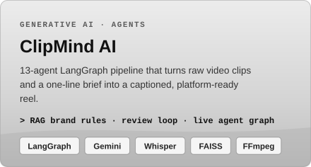</a></td>
    <td width="50%"><a href="https://github.com/Abhxym/supplychain-x">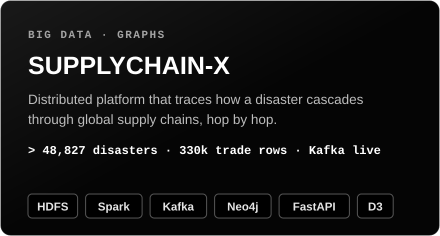</a></td>
  </tr>
  <tr>
    <td width="50%"><a href="https://github.com/Abhxym/redrob-ai">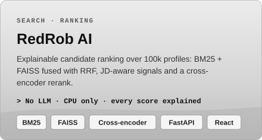</a></td>
    <td width="50%"><a href="https://github.com/Abhxym/InsightFlow">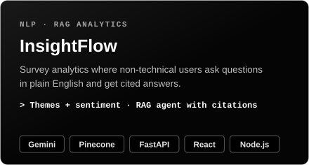</a></td>
  </tr>
  <tr>
    <td width="50%"><a href="https://github.com/Abhxym/Glaucoma-AI">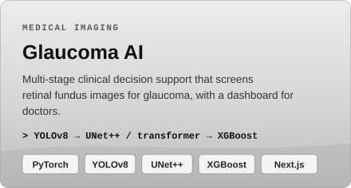</a></td>
    <td width="50%"><a href="https://siddhi-hygiene.vercel.app">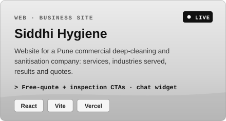</a></td>
  </tr>
  <tr>
    <td width="50%"></td>
    <td width="50%"><a href="https://abhxym.github.io/system-design-atlas/"></a></td>
  </tr>
</table>

Click a card to open the project. LIVE cards open the deployed sites; their code is in <a href="https://github.com/Abhxym/siddhi-hygiene">siddhi-hygiene</a>, <a href="https://github.com/Abhxym/schoolmonitor">schoolmonitor</a> and <a href="https://github.com/Abhxym/system-design-atlas">system-design-atlas</a>.

 

<table>
  <tr>
    <td width="50%" valign="top">
      
      
<b>ClipMind AI</b> · 13 agents plan, caption and cut a reel from raw clips

    </td>
    <td width="50%" valign="top">
      
      
<b>SUPPLYCHAIN-X</b> · Typhoon Hagibis spreading through supply links, hop by hop

    </td>
  </tr>
  <tr>
    <td width="50%" valign="top">
      
      
<b>RedRob AI</b> · explainable candidate ranking you can defend

    </td>
    <td width="50%" valign="top">
      
      
<b>InsightFlow</b> · survey analytics with plain-English questions

    </td>
  </tr>
  <tr>
    <td colspan="2" align="center" valign="top">
      <a href="https://siddhi-hygiene.vercel.app">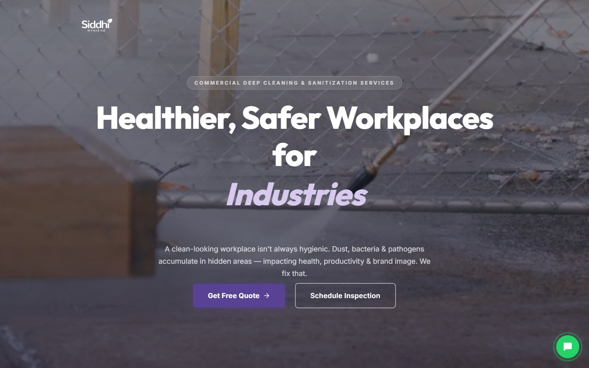</a>
      
<b>Siddhi Hygiene</b> · landing page for a Pune commercial cleaning company (<a href="https://siddhi-hygiene.vercel.app">live</a>)

    </td>
  </tr>
</table>

 

  
  
  
  
  
   
  
  
  
  
  
  
   
  
  
  
  
  
  
   
  
  
  
  
  
  
   
  
  
  
  
  
  
   
  
  
  
  
  
  

 

  
  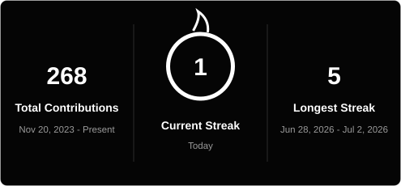

  

Public activity, refreshed daily by a GitHub Action.

 

| Project | What it is | Stack |
|---|---|---|
| [**Glaucoma segmentation**](https://github.com/Abhxym/Unet-and-Yolo-segmentation-for-Glaucoma-Detection) | Coarse-to-fine optic disc and cup segmentation on Drishti-GS1: YOLOv8 crop, then a ResNet34 UNet++ with test-time augmentation (>91% vCDR accuracy). | PyTorch · YOLOv8 · UNet++ |
| [**Real Estate Analytics**](https://github.com/Abhxym/Real_Estate_Data_Curation) | Seven-page analytics dashboard for customers, properties, brokers and deals, with price-prediction and deal-status models. | Python · Streamlit · scikit-learn |
| [**RedRob AI v1**](https://github.com/Abhxym/redrob-ai-main) | First version of the candidate ranker, built for the India Runs Data & AI Challenge. | Streamlit · Sentence-Transformers · FAISS |

