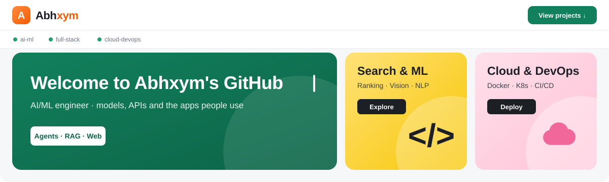
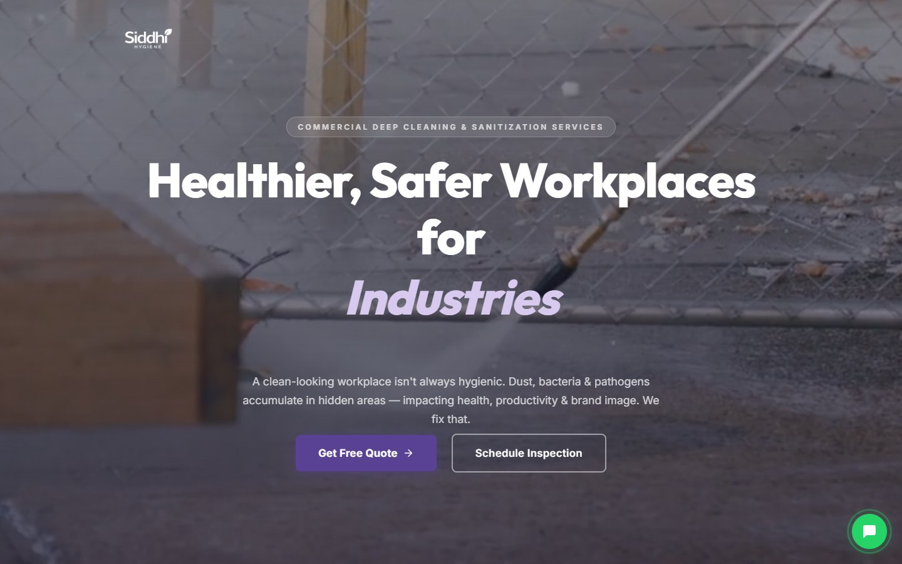

  

  
  
  
  
  
  <!-- Add your profiles here, e.g.:
  
  
  -->

 

Hello there! I'm **Abhxym**, an AI/ML engineer who builds systems end to end, from the model or retrieval pipeline to the API and the interface people actually use. Most of my work sits where **LLM agents, search and data engineering** meet, and lately I ship it the cloud-native way with **Docker, Kubernetes and CI/CD**. I like results that explain themselves: every score with its reasons, every README with its limits.

  🤖 <b>Multi-agent & RAG pipelines</b> with LangGraph, FAISS, Pinecone and rerankers 
  🔎 <b>Search & ranking</b>: BM25 + dense retrieval, rank fusion, explainable scoring 
  🛰️ <b>Big-data platforms</b> on HDFS, Spark, Kafka and Neo4j 
  🧠 <b>Computer vision</b> for medical imaging 
  🌐 <b>Full-stack apps</b> deployed and in use 
  ☁️ <b>Cloud & DevOps</b>: microservices, Kubernetes, Jenkins, Terraform, Ansible

 
 

<table>
  <tr>
    <td width="50%" valign="top">
      <h3><a href="https://github.com/Abhxym/supplychain-x">SUPPLYCHAIN-X</a></h3>
      
      
Distributed platform that traces how a disaster cascades through global supply chains, hop by hop. 48,827 disaster events, 330k trade rows and a live Kafka feed.

      
HDFS · Spark · Kafka · Neo4j · FastAPI · D3

      
<a href="https://github.com/Abhxym/supplychain-x">View on GitHub</a>

    </td>
    <td width="50%" valign="top">
      <h3><a href="https://github.com/Abhxym/redrob-ai">RedRob AI</a></h3>
      
      
Explainable candidate ranking over 100k profiles: BM25 + FAISS fused with RRF, JD-aware signals and a cross-encoder rerank. No LLM, CPU only.

      
BM25 · FAISS · Cross-encoder · FastAPI · React

      
<a href="https://github.com/Abhxym/redrob-ai">View on GitHub</a>

    </td>
  </tr>
  <tr>
    <td width="50%" valign="top">
      <h3><a href="https://github.com/Abhxym/InsightFlow">InsightFlow</a></h3>
      
      
Survey analytics where non-technical users ask questions in plain English: themes and sentiment, plus a RAG agent that answers with citations.

      
Gemini · Pinecone · FastAPI · React · Node.js · MySQL

      
<a href="https://github.com/Abhxym/InsightFlow">View on GitHub</a>

    </td>
    <td width="50%" valign="top">
      <h3><a href="https://github.com/Abhxym/Glaucoma-AI">Glaucoma AI</a></h3>
      
      
Multi-stage clinical decision support that screens retinal fundus images for glaucoma (YOLOv8 → UNet++ / transformer → XGBoost), with a dashboard for doctors.

      
PyTorch · YOLOv8 · UNet++ · XGBoost · Next.js

      
<a href="https://github.com/Abhxym/Glaucoma-AI">View on GitHub</a>

    </td>
  </tr>
  <tr>
    <td width="50%" valign="top">
      <h3><a href="https://siddhi-hygiene.vercel.app">Siddhi Hygiene</a></h3>
      
      
Website for a Pune commercial deep-cleaning and sanitisation company: services, industries served, results, free-quote and inspection requests.

      
React · Vite · Vercel

      
<a href="https://siddhi-hygiene.vercel.app">Live site</a> · <a href="https://github.com/Abhxym/siddhi-hygiene">Code</a>

    </td>
    <td width="50%" valign="top">
      <h3><a href="https://schoolmonitor.vercel.app">School Monitor</a></h3>
      
      
Monitoring system for 12 Zilla Parishad schools: attendance, events, reports, GR publishing and a public transparency page, with role-based access.

      
Next.js · Express · MongoDB · JWT · Google OAuth

      
<a href="https://schoolmonitor.vercel.app">Live site</a> · <a href="https://github.com/Abhxym/schoolmonitor">Code</a>

    </td>
  </tr>
  <tr>
    <td width="50%" valign="top">
      <h3><a href="https://abhxym.github.io/system-design-atlas/">System Design Atlas</a></h3>
      
      
Animated, interactive reference for 111 system design concepts across 16 domains, with trade-offs, real examples and interview prep.

      
HTML · Canvas · JavaScript

      
<a href="https://abhxym.github.io/system-design-atlas/">Live site</a> · <a href="https://github.com/Abhxym/system-design-atlas">Code</a>

    </td>
    <td width="50%" valign="top">
      <h3><a href="https://github.com/Abhxym/ClipMind-AI">ClipMind AI</a></h3>
      
      
13-agent LangGraph pipeline that turns raw video clips and a one-line brief into a captioned, platform-ready reel, with brand-guide RAG and a review loop.

      
LangGraph · Gemini · Whisper · FAISS · FFmpeg · React

      
<a href="https://github.com/Abhxym/ClipMind-AI">View on GitHub</a>

    </td>
  </tr>
</table>

 

<table>
  <tr>
    <td width="50%" valign="top">
      <h3><a href="https://github.com/Abhxym/ecommerce-microservices-docker">ShopEase</a></h3>
      
      
Online marketplace split into three microservices in three languages (Java, Node.js, Python), with a React storefront, a seller panel and one MySQL database. Health checks, startup ordering and a MySQL upgrade without data loss, all from one <code>docker compose up</code>.

      
Spring Boot · Express · Flask · MySQL · React · nginx · Docker Compose

      
<a href="https://github.com/Abhxym/ecommerce-microservices-docker">View on GitHub</a>

    </td>
    <td width="50%" valign="top">
      <h3><a href="https://github.com/Abhxym/kubepulse">KubePulse</a></h3>
      
      
Node.js dashboard on Minikube that shows which pod served each request, with built-in load-balancing and self-healing tests, health probes, an HPA and a Prometheus <code>/metrics</code> endpoint.

      
Node.js · Docker · Kubernetes · Minikube · HPA · Prometheus

      
<a href="https://github.com/Abhxym/kubepulse">View on GitHub</a>

    </td>
  </tr>
  <tr>
    <td width="50%" valign="top">
      <h3><a href="https://github.com/Abhxym/taskflow-cicd">TaskFlow CI/CD</a></h3>
      
      
Task board shipped by a Jenkins pipeline: tests, image build, Terraform validate, deploy to staging, smoke test, manual approval, then production. Jenkins itself is configured as code.

      
Jenkins · Terraform · Docker · Nginx · Node.js

      
<a href="https://github.com/Abhxym/taskflow-cicd">View on GitHub</a>

    </td>
    <td width="50%" valign="top">
      <h3><a href="https://github.com/Abhxym/devops-ansible-case-study">Ansible Automation</a></h3>
      
      
Ansible roles that set up two web servers and an Nginx load balancer for the ShopEase site, with rolling updates one server at a time, config-tested reloads and a verify playbook.

      
Ansible · Nginx · Docker · GitHub Actions

      
<a href="https://github.com/Abhxym/devops-ansible-case-study">View on GitHub</a>

    </td>
  </tr>
</table>

 

<table>
  <tr>
    <td colspan="2" align="center" valign="top">
      
      
<b>ShopEase</b> · storefront backed by three microservices, each in its own container

    </td>
  </tr>
  <tr>
    <td width="50%" valign="top">
      
      
<b>SUPPLYCHAIN-X</b> · Typhoon Hagibis spreading through supply links, hop by hop

    </td>
    <td width="50%" valign="top">
      
      
<b>RedRob AI</b> · explainable candidate ranking you can defend

    </td>
  </tr>
  <tr>
    <td width="50%" valign="top">
      
      
<b>InsightFlow</b> · survey analytics with plain-English questions

    </td>
    <td width="50%" valign="top">
      
      
<b>Siddhi Hygiene</b> · landing page for a Pune commercial cleaning company

    </td>
  </tr>
  <tr>
    <td width="50%" valign="top">
      
      
<b>KubePulse</b> · 150 requests spread across three pods

    </td>
    <td width="50%" valign="top">
      
      
<b>TaskFlow</b> · deployed to production by Jenkins and Terraform

    </td>
  </tr>
  <tr>
    <td colspan="2" align="center" valign="top">
      
      
<b>ClipMind AI</b> · 13 agents plan, caption and cut a reel from raw clips

    </td>
  </tr>
</table>

 

  
  
  
  
  
   
  
  
  
  
  
  
   
  
  
  
  
  
  
   
  
  
  
  
  
  
   
  
  
  
  
  
  
   
  
  
  
  
  
  
   
  
  
  
  
  
   
  
  
  
  
  

 

| Project | What it is | Stack |
|---|---|---|
| [**Glaucoma segmentation**](https://github.com/Abhxym/Unet-and-Yolo-segmentation-for-Glaucoma-Detection) | Coarse-to-fine optic disc and cup segmentation on Drishti-GS1: YOLOv8 crop, then a ResNet34 UNet++ with test-time augmentation (>91% vCDR accuracy). | PyTorch · YOLOv8 · UNet++ |
| [**Real Estate Analytics**](https://github.com/Abhxym/Real_Estate_Data_Curation) | Seven-page analytics dashboard for customers, properties, brokers and deals, with price-prediction and deal-status models. | Python · Streamlit · scikit-learn |
| [**ShopEase Project Management**](https://github.com/Abhxym/project-management) | Full plan for the ShopEase store: charter and WBS, CPM schedule with an S-curve budget, a live [Kanban board with EVM](https://abhxym.github.io/project-management/assignment-3-kanban-execution/ShopEase_Kanban_Board.html) and a [risk register with Monte Carlo](https://abhxym.github.io/project-management/assignment-4-risk-management/ShopEase_Risk_Register.html). | Excel · HTML · JavaScript |
| [**RedRob AI v1**](https://github.com/Abhxym/redrob-ai-main) | First version of the candidate ranker, built for the India Runs Data & AI Challenge. | Streamlit · Sentence-Transformers · FAISS |

